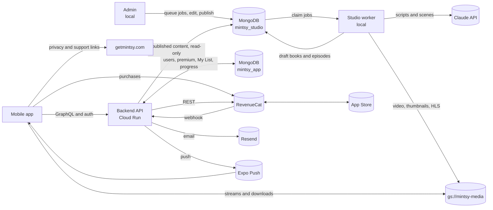

# System overview

| Service | Where | What it is | Runs on |
|---|---|---|---|
| [Backend](backend/index.md) | `mintsy-web/apps/backend` | Express, Apollo GraphQL and Better Auth API | Cloud Run, `api.getmintsy.com` |
| [Studio](services/studio.md) | `mintsy-studio` | Book PDF to episode video (Claude, Kokoro, Remotion) | A staff machine |
| [Admin](services/admin.md) | `mintsy-web/apps/admin` | Content dashboard: upload, review, edit, publish | A staff machine, `127.0.0.1:3001`, never deployed |
| [Mobile](services/mobile.md) | `mintsy-web/apps/mobile` | Expo and React Native app, iOS first | App Store through EAS |
| [Web](services/web.md) | `mintsy-web/apps/web` | Landing, privacy and support pages | Vercel, `getmintsy.com` |
| Docs | `mintsy-web/apps/docs` | These pages (VitePress) | A staff machine, `127.0.0.1:3002`, never deployed |

## How they connect

Web doesn't call the API.

## How an episode goes live

1. Upload a PDF in admin. This queues an `ingest` job.
2. The studio worker extracts the book and saves it as a draft with its chapter list.
3. A `script` job has Claude write the narration, summary, takeaways and scenes.
4. Staff review and edit the script in admin.
5. A `render` job voices and renders the episode, uploads it, and saves it as a draft. A preview render stays on the machine and doesn't upload.
6. Staff check the video and fix any text.
7. Staff publish the episodes, then the book. It goes live on the app's next fetch, with no release or deploy.

## Environments

| | Development | Production |
|---|---|---|
| App | `Mintsy Dev`, `com.getmintsy.app.dev`, scheme `mintsy-dev`, RevenueCat `test_` keys | `Mintsy`, `com.getmintsy.app`, scheme `mintsy`, RevenueCat `appl_` and `goog_` keys. The EAS `preview` profile uses these too. |
| API | `pnpm dev` on `localhost:4000` | Cloud Run `mintsy-api`, project `mintsy-prod`, `us-central1` |
| Database | Docker MongoDB, single-node replica set | Atlas `cluster0.vwithck`: `mintsy_app` and `mintsy_studio` |
| Media | Same bucket | `gs://mintsy-media`, public |
| Admin and studio worker | Local. Use a local MongoDB for testing, because publishing against Atlas is live for every user. | Not deployed |

## What deploys what

| Action | Result |
|---|---|
| Push to `mintsy-web` `main` touching `apps/backend/**` or `backend.yml` | Deploys the API to Cloud Run |
| Push to `mintsy-web` `main` touching `apps/web`, `packages/` or the root workspace files | Vercel deploys the website |
| Push to `mintsy-web` `main` touching only `apps/docs` | Nothing deploys |
| Publishing in admin against Atlas | Live in the app immediately |
| `eas build`, `eas submit`, `eas update` | App builds, store submissions and over-the-air updates |

## Accounts and services

| Service | Used for | Configured in |
|---|---|---|
| Google Cloud `mintsy-prod` | Cloud Run, Artifact Registry, Secret Manager, Cloud Storage, Vertex AI | GitHub Actions through Workload Identity, which trusts only `castroaillc/mintsy-web` on `main` |
| MongoDB Atlas | Both databases | Backend: `MONGODB_URI` secret. Studio: `studio/.env`. Admin: `apps/admin/.env.local`. |
| Vercel `castro-ais-projects` | Website | Project `mintsy-web` |
| Expo / EAS `castroai/mintsy` | Builds, TestFlight, push | `eas.json`, `app.config.ts` |
| App Store Connect, app `6827671481` | App and subscriptions | `eas.json` |
| RevenueCat | Subscriptions | App: `EXPO_PUBLIC_REVENUECAT_IOS_KEY`, `_ANDROID_KEY`. Backend: `REVENUECAT_SECRET_API_KEY`, `REVENUECAT_WEBHOOK_AUTH`. |
| Resend | Transactional email | Backend: `RESEND_API_KEY`, `EMAIL_FROM` |
| Google Workspace | `support@getmintsy.com` | Secondary domain on the Workspace account |
| Anthropic | Scripts and scenes in the studio | `ANTHROPIC_API_KEY` |
| Network Solutions | DNS, see [Web](services/web.md#dns) | |
