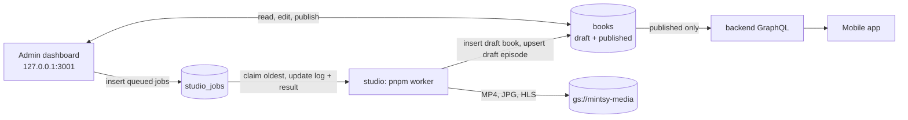

# Admin (`mintsy-web/apps/admin`)

The internal content dashboard: staff find or upload a book, have the studio worker generate episodes, review and edit them, and publish them to the app. Next.js 16 (App Router), shadcn/ui, the `mongodb` driver, zod. Package name `mintsy-admin`.

It runs **only on a staff machine** (`pnpm dev:admin` from the `mintsy-web` root, bound to `127.0.0.1:3001`) and has **no sign-in**. There's no deployment config, on purpose, and `pnpm build` refuses to run on Vercel (`scripts/refuse-deploy.mjs`).

::: danger
**Publish goes live in the app immediately.** The dashboard writes straight to the MongoDB `books` collection that the backend's GraphQL API serves. Flipping a book or an episode to *Published* shows it to every user on their next fetch. Test against a local MongoDB, never production.
:::

## How it fits together



- Everything the dashboard touches lives in one database, `mintsy_studio`: `books`, `studio_jobs` and `studio_workers`. The studio worker reads and writes the same database, and the backend reads `books` from it. User data (accounts, entitlements, My List) is in a separate database, `mintsy_app`, that the dashboard never accesses. The dashboard needs only readWrite on `mintsy_studio` and creates no indexes; the worker creates them.
- `books` is the catalog's source of truth. Books and episodes carry `status: "draft" | "published"` (missing = published) and `updatedAt`.
- The dashboard **inserts** jobs (`status: "queued"`, `log: []`, `createdAt`) and never updates them; the worker owns them after that. The one exception is **Cancel queued jobs**, which deletes a book's jobs while they're still `queued`. The worker's claim is atomic, so a job is either claimed and finishes, or deleted and never runs.
- The PDF is saved to `UPLOAD_DIR/<bookId>.pdf` and the worker reads it from disk. Local previews are read from the worker's `work/` folder. So both must run on the same machine.
- Shapes: [Contracts](../contracts.md) ("Catalog", "Studio jobs"), mirrored in `src/lib/types.ts`. Catalog types come from `@mintsy/shared`.

::: warning
Production stays on the old cluster and the flat `mintsy` database until the [database split](../backend/deployment/index.md#splitting-the-database) is done. Until then, reaching production data takes `MONGODB_DB=mintsy` set explicitly; the default points at a database the API doesn't read.
:::

## Pages

| Page | Route | What staff do |
|---|---|---|
| Books | `/` | List of every book with its status |
| Find books | `/find` | Search public-domain books and import one |
| New book | `/books/new` | Upload a PDF and pick a book id |
| Book | `/books/[id]` | Metadata, cover, the book's publish toggle, chapters with their state, Generate whole book, and the book's jobs with live logs |
| Chapter | `/books/[id]/chapters/[n]` | Generate the script, render a local preview, upload it |
| Script review | `/books/[id]/chapters/[n]/script` | Edit title, summary, takeaways, narration, or the raw `script.json` / `scenes.json`, then queue a render |
| Episode editor | `/books/[id]/episodes/[n]` | Watch the video, fix text and transcript timing, publish or unpublish |
| Jobs | `/jobs` | The queue, across all books |

The nav shows which database the dashboard is on.

## Workflow

1. **New book:** pick the PDF and a book id (`^[a-z0-9][a-z0-9-]*$`, unique; it becomes the app's book id and can't change). The PDF is saved to `UPLOAD_DIR/<bookId>.pdf` (200 MB at most) and an `ingest` job is queued.
2. **Ingest** (worker) creates the draft book and the chapter list, and renders a local cover. The book page shows the live log.
3. **Per chapter:** **Generate script** → **Review script** → **Render**. A full render creates or replaces the episode as a **draft**, and sets its title, summary and takeaways from `script.json`. A preview render stays in `studio/work` until you upload it from the chapter page. Or use **Generate whole book** on the book page (see below).
4. **Metadata** (book page): the category must be one of the app's six chips (`Finance`, `Business`, `Psychology`, `Productivity`, `History`, `Health`; `CATEGORIES` from `@mintsy/shared`, re-exported by `src/lib/schemas.ts`). A stored book with any other category is shown as invalid and can't be saved until you pick one. **Order** sets the catalog position: the app features the book with the lowest order on Home and shows the highest-order books as "Recently added".
5. **Cover** (book page): queues a `cover` job that renders the cover from the saved title, author, category and cover tone. Uploading it sets `coverPath`, and if the book is live the apps show it right away.
6. **Episode editor:** watch the video, fix text and transcript timing, then **Publish**.
7. **Publish the book** with the toggle on the book page.

### Find books

Only offers public-domain books mintsy can legally turn into episodes: published before 1931 (US), and worldwide when every author and translator died in 1955 or earlier. Uploader-set "public domain" or Creative Commons tags aren't trusted on their own. Sources are Project Gutenberg and the Internet Archive (`src/lib/book-sources.ts`). Gutenberg has no PDFs, so its text is converted to a PDF on import. Importing saves the PDF and queues `ingest`, the same as New book. It's a screening tool, not legal advice: check the title page of anything you publish.

### Generate whole book

Queues, per chapter in order, a `script` job then a preview `render` job, and shows what it will do and cost before anything is queued (`src/lib/generate-all.ts`; about $0.35-0.50 of Claude per chapter, $0.25-0.40 when `script.json` already exists). You can pick which chapters to include. It skips the per-chapter script review. Nothing is uploaded or published: you review each preview on its chapter page and upload it from there.

It only queues what's missing, so clicking it again retries failures without paying twice:

| Chapter | Queued |
|---|---|
| Episode published or live, or an uploaded draft | nothing |
| Has a queued or running job | nothing |
| Local render newer than `script.json` and `scenes.json` | nothing |
| Script job succeeded, or both files on disk | render |
| Otherwise | script + render |

Each job gets its own `createdAt` millisecond because the worker sorts on nothing else.

If a script job fails, later chapters keep going. That chapter's render job still runs and, since the worker runs any missing earlier step, it **tries the script again (a second paid call)**. The dashboard shows the script's error as the cause.

**Cancel queued jobs** deletes all of the book's queued jobs; the running one finishes.

### Publishing rules

In `src/lib/status.ts`, enforced by the route handlers. The backend's public API applies the same contiguous-run rule when it reads.

- Episodes go live only as a contiguous run from episode 1: you can publish episode *n* only when 1..*n*−1 are published, and unpublish only the highest published one.
- Re-rendering an episode returns it to draft, which hides it and every later episode from the app until you publish it again.

## Setup

Needs Node 24+, pnpm, and a MongoDB you can reach locally.

```sh
# from the mintsy-web repo root (one lockfile for the workspace)
pnpm install
cp apps/admin/.env.example apps/admin/.env.local   # then edit
```

| Variable | Default | Meaning |
|---|---|---|
| `MONGODB_URI` | `mongodb://127.0.0.1:27017` | MongoDB connection string. Must match the studio worker's |
| `MONGODB_DB` | `mintsy_studio` | Database holding `books`, `studio_jobs` and `studio_workers`. Must match the studio worker's |
| `MEDIA_BASE_URL` | `https://storage.googleapis.com/mintsy-media` | Public prefix for episode videos and thumbnails (`MEDIA_BASE_URL + "/" + path`) |
| `UPLOAD_DIR` | `apps/admin/uploads` (the app's working directory) | Where PDFs are saved. The worker reads them from here, so it must be on the same machine |
| `STUDIO_WORK_DIR` | `../../../studio/work` from the app's working directory | The worker's output folder, for local previews on chapter pages |

For a throwaway local database:

```sh
docker run -d --name mintsy-admin-mongo -p 127.0.0.1:27018:27017 mongo:7
# MONGODB_URI=mongodb://127.0.0.1:27018
```

## Running

One command runs the dashboard and the studio worker together, both on the admin's `MONGODB_URI` / `MONGODB_DB` / `UPLOAD_DIR` (from `apps/admin/.env.local`, with the defaults above), so they can't drift onto different databases. The worker still reads its keys from `studio/.env`. Set `STUDIO_DIR` if `studio/` isn't at `../../../studio` from the app.

```sh
pnpm dev:studio      # from the mintsy-web repo root; Ctrl-C stops both
```

Or two terminals, both pointing at the same `MONGODB_URI` / `MONGODB_DB`:

```sh
# 1. dashboard → http://127.0.0.1:3001 (from the mintsy-web repo root)
pnpm dev:admin

# 2. studio worker (processes the queue one job at a time)
cd studio && pnpm worker
```

Workers write a heartbeat to `studio_workers` every 5 seconds. If jobs are queued and no worker has beaten on the dashboard's database in the last 15 seconds, the dashboard says so straight away and names the database. Before the first poll, or with a worker that predates heartbeats, it falls back to a banner once jobs have sat queued for over 30 seconds. A worker that predates a job feature (preview render, upload, cover) gets that job refused, with a message to restart it.

To try the whole flow without calling Claude, Kokoro, Remotion, ffmpeg or the bucket, run the worker in dry-run mode against a local database. It still writes `studio_jobs` and `books`:

```sh
cd studio && STUDIO_WORKER_DRY_RUN=1 MONGODB_URI=mongodb://127.0.0.1:27018 MONGODB_DB=mintsy_studio pnpm worker
```

## Scripts

| Script | What it does |
|---|---|
| `pnpm dev` | Dev server on 127.0.0.1:3001 (`pnpm dev:admin` from the repo root) |
| `pnpm dev:studio` | Dashboard and worker together (also from the repo root) |
| `pnpm lint` | ESLint |
| `pnpm typecheck` | Generate route types, then `tsc --noEmit` |
| `pnpm build` | Production build (checks everything compiles; refuses to run on Vercel) |
| `pnpm start` | Serves that build on 127.0.0.1:3001 |

## Code map

| Path | What |
|---|---|
| `src/lib/types.ts` | Contract types (`BookDoc`, `EpisodeDoc`, `StudioJob`, results) |
| `src/lib/mongo.ts` | The single MongoDB client |
| `src/lib/env.ts` | Env vars and their defaults |
| `src/lib/schemas.ts` | zod schemas for every write |
| `src/lib/status.ts` | Publish rules (contiguous run from episode 1) |
| `src/lib/catalog.ts`, `src/lib/jobs.ts` | Reads, chapter-state derivation, job inserts |
| `src/lib/generate-all.ts`, `src/lib/generate-all-plan.ts` | Generate whole book: what to queue, job order, progress |
| `src/lib/book-sources.ts`, `src/lib/ingest.ts` | Find books; saving a PDF and queueing `ingest` |
| `src/lib/studio-work.ts`, `src/lib/job-steps.ts` | Read-only access to `studio/work`; turning a job's log into steps |
| `src/app/api/**` | Route handlers for all writes (JSON; PDF upload is multipart) |
| `src/app/**/page.tsx` | The pages above |

Writes go through route handlers that refuse cross-origin browser requests, since there's no sign-in (`rejectCrossOrigin` in `src/lib/api.ts`).
