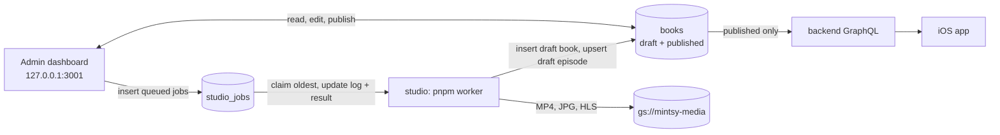

# Admin (`mintsy-web/apps/admin`)

The internal content dashboard: staff find or upload a book, have the studio worker generate episodes, review and edit them, and publish them to the app. Next.js 16 (App Router), shadcn/ui, the `mongodb` driver, zod. Package name `mintsy-admin`.

It runs **only on a staff machine** (`pnpm dev:admin` from the `mintsy-web` root, bound to `127.0.0.1:3001`) and has **no sign-in**. There's no deployment config, on purpose, and `pnpm build` refuses to run on Vercel (`scripts/refuse-deploy.mjs`).

::: danger
**Publish goes live for every user.** The dashboard writes straight to the MongoDB `books` collection that the backend's GraphQL API serves. Flipping a book or an episode to *Published* reaches the API within about 15 to 60 seconds, because the API keeps the catalog in memory ([how fast a publish shows](../backend/catalog/index.md#how-the-api-reads-it-and-how-fast-a-publish-shows)), and then each app on its next fetch. Test against a local MongoDB, never production.
:::

## How it fits together



- Everything the dashboard touches lives in one database, `mintsy_studio`: `books`, `studio_jobs` and `studio_workers`. The studio worker reads and writes the same database, and the backend reads `books` from it. User data (accounts, entitlements, My List) is in a separate database, `mintsy_app`, that the dashboard never accesses. The dashboard needs only readWrite on `mintsy_studio` and creates no indexes; the worker creates them.
- `books` is the catalog's source of truth. Books and episodes carry `status: "draft" | "published"` (missing = published) and `updatedAt`.
- The dashboard **inserts** jobs (`status: "queued"`, `log: []`, `createdAt`) and never updates them; the worker owns them after that. The one exception is **Cancel queued jobs**, which deletes a book's jobs while they're still `queued`. The worker's claim is atomic, so a job is either claimed and finishes, or deleted and never runs.
- The PDF is saved to `UPLOAD_DIR/<bookId>.pdf` and the worker reads it from disk. Local previews are read from the worker's `work/` folder. So both must run on the same machine.
- Shapes: [Contracts](../contracts.md) ("Catalog", "Studio jobs"), mirrored in `src/lib/types.ts`. Catalog types come from `@mintsy/shared`.

::: warning
Production stays on the old cluster and the flat `mintsy` database until the [database split](../backend/deployment/index.md#splitting-the-database) is done. Until then, reaching production data takes `MONGODB_DB=mintsy` set explicitly; the default points at a database the API doesn't read.
:::

## Pages

| Page | Route | What staff do |
|---|---|---|
| Books | `/` | List of every book with its status |
| Find books | `/find` | Search public-domain books and import one |
| New book | `/books/new` | Upload a PDF and pick a book id |
| Book | `/books/[id]` | Metadata, cover, the book's publish toggle, chapters with their state, Generate whole book, and the book's jobs with live logs; select drafts and publish several at once |
| Chapter | `/books/[id]/chapters/[n]` | Generate the script, render a local preview, upload it, render vertical clips, remaster an existing episode |
| Script review | `/books/[id]/chapters/[n]/script` | Edit title, summary, takeaways, narration, or the raw `script.json` / `scenes.json`, then queue a render |
| Episode editor | `/books/[id]/episodes/[n]` | Watch the video, fix text and transcript timing, publish or unpublish |
| Jobs | `/jobs` | The queue, across all books |

The nav shows which database the dashboard is on.

## Workflow

1. **New book:** pick the PDF and a book id (`^[a-z0-9][a-z0-9-]*$`, unique; it becomes the app's book id and can't change). The PDF is saved to `UPLOAD_DIR/<bookId>.pdf` (200 MB at most) and an `ingest` job is queued.
2. **Ingest** (worker) creates the draft book and the chapter list, and renders a local cover. The book page shows the live log.
3. **Per chapter:** **Generate script** → **Review script** → **Render**. A full render creates or replaces the episode as a **draft**, and sets its title, summary and takeaways from `script.json`. A preview render stays in `apps/studio/work` until you upload it from the chapter page. It renders one video per voice, so it takes about three times as long as a single video, and the chapter page shows each one. Or use **Generate whole book** on the book page (see below).
4. **Metadata** (book page): the category must be one of the app's six chips (`Finance`, `Business`, `Psychology`, `Productivity`, `History`, `Health`; `CATEGORIES` from `@mintsy/shared`, re-exported by `src/lib/schemas.ts`). A stored book with any other category is shown as invalid and can't be saved until you pick one. **Order** sets the catalog position: the app features the book with the lowest order on Home and shows the highest-order books as "Recently added".
5. **Cover** (book page): queues a `cover` job that renders the cover from the saved title, author, category and cover tone. Uploading it sets `coverPath`, and if the book is live the apps show it once the API's catalog copy refreshes ([within about 15 to 60 s](../backend/catalog/index.md#how-the-api-reads-it-and-how-fast-a-publish-shows)).
6. **Episode editor:** watch the video, fix text and transcript timing, then **Publish**.
7. **Publish the book** with the toggle on the book page.

### Find books

Only offers public-domain books mintsy can legally turn into episodes: published before 1931 (US), and worldwide when every author and translator died in 1955 or earlier. Uploader-set "public domain" or Creative Commons tags aren't trusted on their own. Sources are Project Gutenberg and the Internet Archive (`src/lib/book-sources.ts`). Gutenberg has no PDFs, so its text is converted to a PDF on import. Importing saves the PDF and queues `ingest`, the same as New book. It's a screening tool, not legal advice: check the title page of anything you publish.

### Generate whole book

Queues, per chapter in order, a `script` job then a preview `render` job, and shows what it will do and cost before anything is queued (`src/lib/generate-all.ts`). The dialog's Claude figures, about $0.35-0.50 per chapter and $0.25-0.40 when `script.json` already exists, are old estimates at API rates, not real spend: Claude calls now use [subscription limits](studio.md#claude-usage). You can pick which chapters to include. It skips the per-chapter script review. Nothing is uploaded or published: you review each preview on its chapter page and upload it from there.

It only queues what's missing, so clicking it again retries failures without redoing finished work:

| Chapter | Queued |
|---|---|
| Episode published or live, or an uploaded draft | nothing |
| Has a queued or running job | nothing |
| Local render newer than `script.json` and `scenes.json` | nothing |
| Script job succeeded, or both files on disk | render |
| Otherwise | script + render |

Each job gets its own `createdAt` millisecond because the worker sorts on nothing else.

If a script job fails, later chapters keep going. That chapter's render job still runs and, since the worker runs any missing earlier step, it **tries the script again (a second Claude call)**. The dashboard shows the script's error as the cause.

If the Claude subscription reaches a usage limit, the job fails with `Claude subscription usage limit reached`. The worker keeps claiming jobs, so the queued jobs that still need Claude fail the same way. **Retry failed** is safe to use later, because it queues only what's still missing.

**Cancel queued jobs** deletes all of the book's queued jobs; the running one finishes.

### Remaster

On the chapter page, for a chapter that already has an episode. A `remaster` job re-renders every voice from the chapter's local script and scenes and swaps the episode's media in place. **It overwrites live media as soon as the job finishes, with no draft step and no undo.** The status, title, summary and takeaways stay. The confirmation says so before anything is queued. What the job does: [Studio](studio.md#worker).

If transcript text in `books` differs from the local scenes, the job refuses, changes nothing and names the lines. Either put the same text into the chapter's script and remaster again, or choose **Discard the edits and remaster**, which sends `overwriteTranscript`. The route accepts `overwriteTranscript` only straight after a refusal: the chapter's latest remaster job must have failed on transcript differences, with no change to the episode since. Otherwise it returns 409 (`src/lib/remaster.ts`).

The backfill has an order rule: [Episode voices](../contracts.md#order-for-the-backfill).

### Vertical clips

On the chapter page, once the chapter has a voice or a clip. Pick a voice, a first scene and a last scene (or Automatic). The form shows how long the clip will run, and blocks a range that breaks the [rules](studio.md#vertical-clips), using `src/lib/clips.ts`, which mirrors studio's check. Studio has the final say, and the job fails for episodes past the free ones.

Finished clips show on the page with a download button. Nothing is uploaded, and posting them is manual. A clip of an episode that wasn't published when it was rendered gets a warning to publish the episode before posting. Clip jobs don't count towards the chapter's state on the book page.

### Editing an episode's transcript

- **Whole seconds:** a changed transcript needs whole-second start times, because the API exposes `startSec` as `Int!` and a fractional value [fails the response](../contracts.md#catalog). An episode that already has fractional times still saves its other fields, because an untouched transcript isn't rechecked or rewritten. The editor offers **Round to whole seconds**.
- **Voiced episodes:** the editor warns that edits only affect the default voice's transcript, not the other voices or the timed captions. The save writes the top-level and default-voice copies in one update. The number of lines can't change, so adding and removing lines is off.
- **Stale forms:** every save sends `baseUpdatedAt`, the episode's `updatedAt` when the form loaded. If the episode has changed since, through a render or another edit, the save gets a 409 and asks you to reload.

### Publishing rules

In `src/lib/status.ts`, enforced by the route handlers. The backend's public API applies the same contiguous-run rule when it reads.

- Episodes go live only as a contiguous run from episode 1: you can publish episode *n* only when 1..*n*−1 are published, and unpublish only the highest published one.
- **Publish several at once** (book page, Chapters): tick drafts, or use the header box to select every draft that can go live in order (it stops at the first chapter with no episode or with a job at work). `POST /api/books/[id]/episodes/status` with `{ numbers, status: "published" }` judges the selection as a whole (`canPublishEpisodes`): each episode exists and is a draft, the published episodes plus the selection form a contiguous run from 1, and the run passes the [API-values check](#publishing-rules) below. Either all are published in one update or none is. If an episode in the run changed between the check and the write, it returns 409 and writes nothing. There's no bulk unpublish.
- A full render or an upload returns an episode to draft, which hides it and every later episode from the app until you publish it again. A remaster keeps the status.

**Values the API can't serve.** One bad value on a public episode [loses the app's whole catalog](../contracts.md#catalog), so the episode and book status routes return 409 for a publish that would expose one, and the page shows the reason with the control disabled. The check covers the whole contiguous run the publish would make public, not just the episode being published. So closing a gap is refused if a later episode already marked published has a bad value, and so is publishing a book whose run has one. It also applies while the book is still a draft.

It looks for `durationSec` and transcript `startSec` values that aren't whole numbers in the API's `Int` range, at the top level and on every voice, and for an episode with voices that doesn't have exactly one default.

This check never blocks unpublishing: a book can always be unpublished, and an episode only has to be the highest published one, under the rule above.

| Problem | Fix |
|---|---|
| Fractional top-level transcript times | **Round to whole seconds** in the episode editor, then save. If two lines round to the same second, the save asks you to separate them |
| Fractional `durationSec`, a non-default voice's times, or a problem with the default voice | Not fixable in the dashboard. Needs a [remaster](#remaster), which needs the chapter's local files |

### Performance

MongoDB is remote, so response time is mostly bytes over the link. The reads keep payloads small:

- **Jobs:** `listJobs` (`src/lib/jobs.ts`) is an aggregation that leaves out script and scene payloads (`result.script`, `result.scenes`, and an edited render's `scriptJson` / `scenesJson`) and finished jobs' logs. It sends `log` only for queued and running jobs, plus `logLines`, `hasEdits` and `dryRun` for every job. `GET /api/jobs/<id>/log` returns one job's full log when the UI shows it (`src/hooks/use-job-log.ts`).
- **Books:** pages read a book through `findPageBook` (`src/lib/catalog.ts`), without voice captions, and with transcripts reduced to the `startSec` values the publish check needs. The episode editor keeps its own episode's top-level transcript whole.
- **Polling:** job polls (`src/hooks/use-jobs.ts`) share one request per URL across every hook on the page and never overlap.

## Setup

Needs Node 24+, pnpm, and a MongoDB you can reach locally.

```sh
# from the mintsy-web repo root (one lockfile for the workspace)
pnpm install
cp apps/admin/.env.example apps/admin/.env.local   # then edit
```

| Variable | Default | Meaning |
|---|---|---|
| `MONGODB_URI` | `mongodb://127.0.0.1:27017` | MongoDB connection string. Must match the studio worker's |
| `MONGODB_DB` | `mintsy_studio` | Database holding `books`, `studio_jobs` and `studio_workers`. Must match the studio worker's |
| `MEDIA_BASE_URL` | `https://storage.googleapis.com/mintsy-media` | Public prefix for episode videos and thumbnails (`MEDIA_BASE_URL + "/" + path`) |
| `UPLOAD_DIR` | `apps/admin/uploads` (the app's working directory) | Where PDFs are saved. The worker reads them from here, so it must be on the same machine |
| `STUDIO_WORK_DIR` | `../studio/work` from the app's working directory | The worker's output folder, for local previews on chapter pages |

Empty values count as unset, so the keys `.env.example` leaves blank use the defaults above, and a blank `MONGODB_URI` falls back to `mongodb://127.0.0.1:27017`.

**Isolating a test run:** `DOTENV_CONFIG_PATH` has no effect on Next, which loads `.env.local` itself. Explicit variables override `.env.local`, so set the ones you want on the command, for example `MONGODB_DB=scratch STUDIO_WORK_DIR=/tmp/scratch pnpm dev:admin`.

For a throwaway local database:

```sh
docker run -d --name mintsy-admin-mongo -p 127.0.0.1:27018:27017 mongo:7
# MONGODB_URI=mongodb://127.0.0.1:27018
```

## Running

One command runs the dashboard and the studio worker together, both on the admin's `MONGODB_URI` / `MONGODB_DB` / `UPLOAD_DIR` (from `apps/admin/.env.local`, with the defaults above), so they can't drift onto different databases. The worker still reads its keys from `apps/studio/.env`, but anything set in the admin's env files reaches it first and wins, including `STUDIO_WORK_DIR`. Set `STUDIO_DIR` to run the worker from a different studio checkout.

```sh
pnpm dev:studio      # from the mintsy-web repo root; Ctrl-C stops both
```

Or two terminals, both pointing at the same `MONGODB_URI` / `MONGODB_DB`:

```sh
# 1. dashboard → http://127.0.0.1:3001 (from the mintsy-web repo root)
pnpm dev:admin

# 2. studio worker (processes the queue one job at a time)
pnpm dev:worker      # from the mintsy-web repo root
```

Workers write a heartbeat to `studio_workers` every 5 seconds. If jobs are queued and no worker has beaten on the dashboard's database in the last 15 seconds, the dashboard says so straight away and names the database. Before the first poll, or with a worker that predates heartbeats, it falls back to a banner once jobs have sat queued for over 30 seconds. If a running worker predates a job feature (preview render, upload, cover, remaster, clip), the dashboard refuses to queue that job, with a message to restart it.

To try the whole flow without calling Claude, Kokoro, Remotion, ffmpeg or the bucket, run the worker in dry-run mode against a local database. It still writes `studio_jobs` and `books`:

```sh
STUDIO_WORKER_DRY_RUN=1 MONGODB_URI=mongodb://127.0.0.1:27018 MONGODB_DB=mintsy_studio pnpm dev:worker
```

## Scripts

| Script | What it does |
|---|---|
| `pnpm dev` | Dev server on 127.0.0.1:3001 (`pnpm dev:admin` from the repo root) |
| `pnpm dev:studio` | Dashboard and worker together (also from the repo root) |
| `pnpm lint` | ESLint |
| `pnpm test` | Unit tests for the publish rules (`node --test`, `test/*.test.mjs`) |
| `pnpm typecheck` | Generate route types, then `tsc --noEmit` |
| `pnpm build` | Production build (checks everything compiles; refuses to run on Vercel) |
| `pnpm start` | Serves that build on 127.0.0.1:3001 |

`pnpm lint`, `pnpm typecheck` and `pnpm build` run on TypeScript 6.0.3, although `package.json` asks for `^7`. The root `pnpm-workspace.yaml` overrides it for the whole root workspace, because no `typescript-eslint` release supports TS 7 (8.72.1, the latest on 2026-11-04, has the peer range `<6.1.0`). Remove the override once one does.

## Code map

| Path | What |
|---|---|
| `src/lib/types.ts` | Contract types (`BookDoc`, `EpisodeDoc`, `StudioJob`, results) |
| `src/lib/mongo.ts` | The single MongoDB client |
| `src/lib/env.ts` | Env vars and their defaults |
| `src/lib/schemas.ts` | zod schemas for every write |
| `src/lib/status.ts` | Publish rules (contiguous run from episode 1, single and bulk) |
| `src/lib/catalog.ts`, `src/lib/jobs.ts` | Reads (`findPageBook`, `listJobs`, `readJobLog`), chapter-state derivation, job inserts |
| `src/hooks/use-jobs.ts`, `src/hooks/use-job-log.ts` | Shared job polling; a finished job's log fetched on demand |
| `src/lib/generate-all.ts`, `src/lib/generate-all-plan.ts` | Generate whole book: what to queue, job order, progress |
| `src/lib/clips.ts` | Clip lengths for the form, mirroring studio's `selectClipScenes` |
| `src/lib/remaster.ts` | Whether an `overwriteTranscript` retry is allowed |
| `src/lib/book-sources.ts`, `src/lib/ingest.ts` | Find books; saving a PDF and queueing `ingest` |
| `src/lib/studio-work.ts`, `src/lib/job-steps.ts` | Read-only access to `apps/studio/work`, including each voice's render and the clips; turning a job's log into steps |
| `src/app/api/**` | Route handlers for all writes (JSON; PDF upload is multipart) |
| `src/app/**/page.tsx` | The pages above |

Writes go through route handlers that refuse cross-origin browser requests, since there's no sign-in (`rejectCrossOrigin` in `src/lib/api.ts`).
