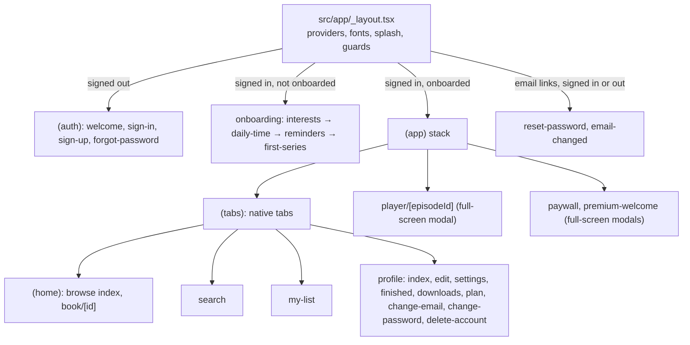

# Mobile (`mintsy-web/apps/mobile`)

This app is its own pnpm workspace with its own lockfile, so Expo and React Native stay out of the backend image. Install with `pnpm install` in `apps/mobile`, and run EAS commands from there.

Expo SDK 58 / React Native app. iOS is the release target (TestFlight → App Store); Android and web build but aren't shipped.

## Getting started

```sh
pnpm install
cp .env.example .env
pnpm start               # expo start; pnpm dev:mobile from the mintsy-web root
```

The output offers a [development build](https://docs.expo.dev/develop/development-builds/introduction/), an [Android emulator](https://docs.expo.dev/workflow/android-studio-emulator/), an [iOS simulator](https://docs.expo.dev/workflow/ios-simulator/) or [Expo Go](https://expo.dev/go), a limited sandbox. Routes are files under `src/app` ([file-based routing](https://docs.expo.dev/router/introduction)).

Checks: `npx expo lint`, `npx tsc --noEmit`, `pnpm test` (`scripts/*.test.mjs`). End-to-end tests are described in `e2e/README.md`.

## Stack

| Concern | Choice |
|---|---|
| Framework | Expo SDK 58, React Native, React 19 with the React Compiler (`experiments.reactCompiler`) |
| Navigation | Expo Router with typed routes; native tabs (`NativeTabs`) |
| UI | NativeWind (Tailwind classes) + gluestack-ui primitives in `src/components/ui`; brand components in `src/components/mintsy`; tokens from [`@mintsy/brand`](brand.md) |
| Fonts | Space Grotesk (display), Inter (body) via `@expo-google-fonts` |
| Auth | Better Auth client with the `@better-auth/expo` plugin; session cookie in `expo-secure-store`. Sign in with Apple and Google through native ID tokens (`lib/social-auth.ts`) |
| API | Hand-rolled GraphQL `fetch` (`src/lib/graphql.ts`) that forwards the auth cookie |
| Video | `expo-video` with custom controls |
| Storage | `expo-secure-store` for session, onboarding answers, preferences, theme; `expo-file-system` for offline downloads and per-user JSON files (`lib/user-files.ts`). Downloads are excluded from iCloud backup by the local module `modules/backup-exclusion` |
| Support | `expo-mail-composer` (feedback email) and `expo-clipboard` (copy the support address) |
| Notifications | `expo-notifications`: Expo push token registration + local daily reminders |
| Purchases | `react-native-purchases` (RevenueCat) |

## Build variants

`app.config.ts` switches on `APP_VARIANT` so all three install side by side. Unset means development, and an unknown value fails rather than building the wrong app.

| Variant | Name | Bundle ID / package | URL scheme | Icon band | EAS profile, channel, environment |
|---|---|---|---|---|---|
| development | Mintsy Dev | `com.getmintsy.app.dev` | `mintsy-dev` | `DEV` | `development` (and `development-simulator`) |
| preview | Mintsy Preview | `com.getmintsy.app.preview` | `mintsy-preview` | `PREVIEW` | `preview` |
| production | Mintsy | `com.getmintsy.app` | `mintsy` | none | `production` (auto-incremented build number, remote app version, submits to App Store Connect app `6827671481`) |

- **Runtime:** `runtimeVersion` uses the fingerprint policy and the config differs per variant, so each variant has its own runtime, and an update only reaches its own builds. Environment variables that change the config count too: setting `EXPO_PUBLIC_GOOGLE_IOS_CLIENT_ID_PREVIEW` adds the Google plugin and changes preview's runtime. `package.json` `scripts` count as well, so changing them changes every variant's runtime; only do that alongside a new native build.
- **Icons:** `scripts/generate-variant-icons.py` makes the dev and preview icons from production's. `ios.icon` isn't set, so iOS uses the top-level `icon`; on Android `android.adaptiveIcon` takes precedence, so its foreground is per variant too. The monochrome (themed) Android icon is shared.
- **Development builds read the config from the dev server,** so `Constants.expoConfig` follows the server's `APP_VARIANT`. Start the server with the variant of the build you open.
- **QR codes:** the generated `exp+mintsy` scheme is claimed by development only, so a dev QR code can't open a preview build or a production build made with this config. Production builds made before it still claim the scheme, so while one is installed next to a development build, iOS may open the wrong one: run `npx expo start --dev-client --scheme mintsy-dev` until it's replaced. Listing `expo-dev-client` for preview and production only sets the scheme: its native code is debug-only and stays out of their Release builds.

Every variant is registered separately outside this code:

| Service | What each variant needs |
|---|---|
| Backend | Its scheme in `trustedOrigins` (`apps/backend/src/auth.ts`) and its bundle ID in `APPLE_APP_BUNDLE_IDENTIFIER` (`apps/backend/src/env.ts`). Preview's aren't there yet: until they are, email sign-in returns 403 `INVALID_ORIGIN` and Apple sign-in is rejected |
| Apple | App ID with Sign in with Apple and Push Notifications; ad hoc devices (`eas device:create`) and a provisioning profile for internal builds; an App Store Connect app with its own subscriptions before StoreKit can sell anything |
| Google | One iOS OAuth client per bundle ID (`EXPO_PUBLIC_GOOGLE_IOS_CLIENT_ID_*`), listed in the backend's `GOOGLE_IOS_CLIENT_ID`. Unset: the button is hidden |
| RevenueCat | One app per bundle ID, with its own public key. Preview reads only `EXPO_PUBLIC_REVENUECAT_*_KEY_PREVIEW`, which must be platform keys: a `test_` key aborts release builds. Unset: purchases are off |
| Expo push | One project for all variants; each bundle ID needs push credentials on EAS |

## Navigation



The root layout uses `Stack.Protected` guards driven by the Better Auth session and the onboarding flag. It holds the splash screen until the session, saved theme, fonts and the catalog are known (plus the onboarding answers on a cold start with a session), so screens never flash. If the catalog can't load it shows a retry screen, unless a signed-in viewer has downloads on the device, who gets in to watch them.

On a wide, landscape display (iPhone Duo open) the tabs move into a sidebar.

## State and data

| Provider / module | Holds | Persistence |
|---|---|---|
| `CatalogProvider` (`lib/catalog.tsx`) | Books → episodes (transcript, takeaways, `videoUrl`, `thumbnailUrl`) from the `books` query; `getBook`, `findEpisode` | Fetched at launch, on sign-in, sign-out or account switch, and quietly when back in the foreground with a stale catalog |
| `PremiumProvider` (`lib/premium.tsx`) | Premium state (`isPremium`, expiry, renewal, plan), `purchase`, `restore`, `refresh`; lock helpers `useIsLocked`, `useOpenEpisode`, `openPaywall` | RevenueCat customer info + backend `me.premium`; nothing stored locally |
| `SavedProvider` (`lib/saved.tsx`) | My List: saved book and episode ids, `isSaved`, `toggle`, `setSaved`, `reload` | API (`me.savedBookIds` / `savedEpisodeIds`, `setSaved`); optimistic, rolled back with an alert on failure; empty while signed out |
| `DownloadsProvider` (`lib/downloads.tsx`) | Offline episodes, active downloads, `download`, `remove`, `removeAll`, `getLocal` | Files on the device (`<documents>/downloads/`) plus `index.json`; never sent to the API |
| `ProgressProvider` (`lib/progress.tsx`) | Per-episode position and completion, seconds watched per day | API (`setProgress`, `continueWatching`, `progress`, `finishedBookIds`), sent about every 10 s while playing and at once on pause, seek, end, exit and backgrounding. Device cache and unsent saves in `users/<id>/`; seconds watched per day stay on the device |
| `OnboardingProvider` (`lib/onboarding.tsx`) | Interests, daily goal, reminder time, completion, resume step | SecureStore, per user |
| `lib/preferences.ts` | Autoplay, captions, Wi-Fi-only downloads, alerts, default speed | SecureStore, per device |
| `ThemeModeProvider` | Light / dark / system | SecureStore |
| `data/types.ts` | Catalog types and client constants; `FREE_EPISODES` and the categories come from `@mintsy/shared` | Code |

Derived views (stats, recommendations, series status) live in `lib/series.ts`, `lib/stats.ts` and `lib/recommend.ts` and take the catalog as input. `lib/library.tsx` (ratings and recent searches on the device) exists but isn't mounted or used by any screen.

## Backend integration

- `EXPO_PUBLIC_API_URL` (default `http://localhost:4000`) is the API base for both auth and GraphQL. The iOS simulator reaches the host through localhost; the Android emulator needs `http://10.0.2.2:4000`, and a physical device needs your LAN IP.
- Auth: `authClient` (`lib/auth-client.ts`) for sign-up/in/out, session, profile updates, `requestPasswordReset`, `resetPassword`, `changeEmail`, `changePassword` and `deleteUser`. Email links return through `RESET_PASSWORD_URL` / `EMAIL_CHANGED_URL` (`lib/deep-links.ts`, built with `Linking.createURL`, so `mintsy://…`, `mintsy-preview://…` or `mintsy-dev://…` per build).
- GraphQL operations: `books` and `book(id)`, `me { premium { ... } }` and `refreshPremium`, `me { savedBookIds savedEpisodeIds }` and `setSaved`, `setProgress` and the progress fields on `me`, `registerPushToken`, `unregisterPushToken`, `sendTestPush`. The catalog query retries without `locked` and `coverUrl` for older backends (`lib/catalog-query.ts`).
- `EXPO_PUBLIC_HLS_ENABLED`: stream over HLS when the API offers `Episode.hlsUrl`. On only when exactly `true`, and never on web. Don't enable it for a build pointing at an API without `hlsUrl`: the catalog request fails and the app loses every book.
- RevenueCat public SDK keys: `EXPO_PUBLIC_REVENUECAT_IOS_KEY`, `EXPO_PUBLIC_REVENUECAT_ANDROID_KEY`, and `EXPO_PUBLIC_REVENUECAT_IOS_KEY_PREVIEW`, `EXPO_PUBLIC_REVENUECAT_ANDROID_KEY_PREVIEW` for the preview variant, which never uses the others. Without the key for a platform, purchases are off there and the paywall shows its retry state.
- Google sign-in: `EXPO_PUBLIC_GOOGLE_WEB_CLIENT_ID`, `EXPO_PUBLIC_GOOGLE_IOS_CLIENT_ID(_DEV|_PREVIEW)`, `EXPO_PUBLIC_GOOGLE_IOS_URL_SCHEME(_DEV|_PREVIEW)`. Leave a variant's variables empty to hide the Google button in that build.

All of these are in `.env.example`.

## Player

`app/(app)/player/[episodeId].tsx` renders a 16:9 panel with custom overlay controls (±10 s, play/pause, scrubber, captions, fullscreen), episode info, previous / speed / save / next, and Transcript and Key takeaways tabs. It unlocks rotation, and it has wide layouts for the iPhone Duo.

| Pose | Window | Layout |
|---|---|---|
| Fully open, upright | about 669×951 | Side by side (`ArrangementView`, iOS 27.1+) |
| Fully open, rotated | about 951×669 | The video fills the screen |
| Half open, upright (horizontal fold) | about 669×951 | Tabletop: video above the fold, controls below |
| Half open, on its side (vertical fold) | about 951×669 | Side by side, with no full-screen button, so nothing tappable sits in the fold. Controls clear the rail on both sides |
| Folded, regular iPhones | compact | Phone layout; on its side the video fills the screen |

- Episodes with a video use `useVideoClock`, which wraps an `expo-video` player and exposes the same interface as the simulated `usePlaybackClock` (used for episodes without one), so the rest of the screen is identical for both. A stream with a fallback that stalls in `loading` for 15 s falls back to the MP4 (`lib/stream-source.ts`, `hooks/use-video-clock.ts`).
- The transcript highlights the active line, auto-scrolls ("following along"), offers "Back to current" after manual scrolling, and seeks on tap. Captions are drawn from the same transcript lines.
- Position is tracked every whole second; finishing marks the episode complete and auto-advances if the preference is on. At the end of the last free episode it upsells instead of advancing into a locked one.

## Wide layouts

`useWideLayout` picks layouts from the window at render time, and its `shortWide` is iPhone Duo open and rotated (951×669). That window is short, so Welcome uses a smaller headline there, and Welcome, Paywall and Premium welcome scroll if a notice or a larger text size needs more room. The paywall's price, billing period, auto-renew terms and legal links all fit without scrolling at the default text size.

`useRailInsets` clears the 84 pt system rail in that pose, on whichever side the window says it's on, because in modals the root provider's insets can read 0 on the rail side. Use it for screens without the player's `verticalBarBehaviorIOS="disabled"`; the player clears both sides itself.

## Premium

`lib/premium.tsx`, `lib/offering.ts`, `components/premium/`. Free accounts get episodes 1–3 of every book (`FREE_EPISODES` from `@mintsy/shared`, mirroring the backend); Premium (monthly or yearly subscription with a free trial, App Store or Google Play) unlocks every episode, full transcripts and takeaways, and downloads. Prices, trial length and the yearly saving are read from the stores through RevenueCat at runtime, so nothing is hard-coded in the app.

- **Identity:** after sign-in the provider calls `Purchases.logIn(<Better Auth user id>)`, so RevenueCat's customer id is the backend user id; it logs out on sign-out and never purchases anonymously.
- **Offering:** `default`, packages `$rc_annual` and `$rc_monthly`, entitlement `premium`. The app tells Yearly from Monthly by the word in the product id. The paywall shows the yearly saving and trial length only when the customer is eligible.
- **Sync:** on the device, RevenueCat customer info drives the UI. After a purchase, restore or entitlement change the app calls `refreshPremium` and refetches the catalog, because the backend decides access: locked episodes arrive with `locked: true`, no `videoUrl`, and empty transcript and takeaways. `isEpisodeLocked` uses the API's `locked` and falls back to `number > FREE_EPISODES` for older backends.
- **Screens:** paywall modal (`/paywall`, optional `episodeId`), `/premium-welcome` after a purchase, `/profile/plan` (current plan, manage, restore), Settings › Subscription row, lock states on the series page (play, transcript, download) and in the player (blocked-episode card), and Downloads as a Premium upsell.
- **Legal links:** `lib/legal.ts`. The paywall's "Terms of Use (EULA)" link (iOS only) points to Apple's standard EULA; Android shows only the Privacy Policy link.

### Store setup checklist

Steve does these steps. This repo doesn't record which are done, so check the consoles.

**Product ids** (suggested): `mintsy_premium_yearly`, `mintsy_premium_monthly`.

**App Store Connect**

- [ ] Agreements, Tax and Banking: sign the **Paid Apps** agreement and add bank and tax details (purchases fail without it).
- [ ] App › Subscriptions: create the subscription group **mintsy Premium**.
- [ ] In it, add the auto-renewable subscriptions `mintsy_premium_monthly` (1 month) and `mintsy_premium_yearly` (1 year), each with price, display name, description and a review screenshot.
- [ ] On each, add an **Introductory Offer**: Free, with the trial length you want (e.g. 1 week), for new subscribers.
- [ ] Users and Access › Sandbox: create **sandbox testers** (sign in on the device under Settings › App Store › Sandbox Account).
- [ ] App Store Connect API › In-App Purchase key: generate it and upload it to RevenueCat (RevenueCat › the iOS app › In-app purchase key configuration).
- [ ] App Information: Privacy Policy URL `https://getmintsy.com/privacy`. For the License Agreement keep **Apple's standard EULA** (don't upload a custom one), and end the App Store description with a Terms of Use line linking to it: `https://www.apple.com/legal/internet-services/itunes/dev/stdeula/`.

**Google Play Console**

- [ ] Monetize › Products › Subscriptions: create `mintsy_premium_monthly` and `mintsy_premium_yearly`, each with an auto-renewing **base plan** (P1M / P1Y) and a **free trial offer** for new customers.
- [ ] Set up a payments profile; add **license testers** (Setup › License testing).
- [ ] Create a Google Cloud service account with Play Console financial access and upload its JSON key to RevenueCat (the Android app's service account credentials).
- [ ] Upload a build with the BILLING permission (any build with `react-native-purchases`) to an internal testing track so the products become available.

**RevenueCat**

- [ ] Create the project **mintsy** and add the apps: App Store (`com.getmintsy.app`) and Play Store (`com.getmintsy.app`). For dev builds also add `com.getmintsy.app.dev` or test with the production bundle id. For Mintsy Preview add an App Store app for `com.getmintsy.app.preview`, with its own subscriptions in App Store Connect.
- [ ] Products: import both products from each store.
- [ ] Entitlements: create **`premium`** and attach all four products (2 per store).
- [ ] Offerings: create **`default`** (make it Current) with the packages **`$rc_monthly`** (Monthly) and **`$rc_annual`** (Annual), each holding the App Store and Play Store product.
- [ ] Project settings › API keys: copy the **public** SDK keys:
  - iOS key (`appl_…`) → `EXPO_PUBLIC_REVENUECAT_IOS_KEY` in `apps/mobile/.env` and the EAS environment variables for the build profiles.
  - Android key (`goog_…`) → `EXPO_PUBLIC_REVENUECAT_ANDROID_KEY`, same places.
- [ ] Create a **v1 secret API key** (`sk_...`; the backend calls the v1 REST API) → `REVENUECAT_SECRET_API_KEY` in the backend's environment (Cloud Run secret). Never in the app.
- [ ] Integrations › Webhooks: URL `https://<backend host>/webhooks/revenuecat`, Authorization header value = a long random string; put the same string in the backend's `REVENUECAT_WEBHOOK_AUTH`. See [Premium and RevenueCat](../backend/features/premium.md#production-setup).
- [ ] App user ids: the app calls `Purchases.logIn(<Better Auth user id>)`, so RevenueCat's `app_user_id` is the backend user id. Leave "Restore behavior" at the default (transfer to new App User ID) unless you decide otherwise.

**After the keys are in**

- [ ] Make a new development build (`eas build --profile development`); `react-native-purchases` is native code and Expo Go only runs RevenueCat's preview mode.
- [ ] Sandbox tests: buy yearly (trial), buy monthly, cancel, restore on a fresh install, let it expire (sandbox renewals are accelerated), switch plans, and sign in as another user (entitlements follow the account).

## Account

`app/reset-password.tsx`, `app/email-changed.tsx`, `app/+native-intent.tsx`, `app/(app)/(tabs)/profile/change-email.tsx`, `change-password.tsx`, `delete-account.tsx`, `lib/account.ts`, `lib/deep-links.ts`. Flows run on Better Auth; emails come from the backend through Resend (see [Account flows](../backend/authentication/account-flows.md)).

- **Reset password:** Forgot password (and Change password's "send a reset link") call `requestPasswordReset` with `redirectTo: RESET_PASSWORD_URL`. The email link opens `<scheme>://reset-password/?token=…`; `+native-intent.tsx` drops the trailing slash so the route matches. `reset-password` sits outside the auth guards, works signed in or out, and sends the user to sign in again afterwards (a reset signs out every session).
- **Change email:** Settings / Edit profile › `profile/change-email` calls `changeEmail` with `callbackURL: EMAIL_CHANGED_URL`; the confirmation goes to the new address, and `email-changed` (outside the guards) refreshes the session or shows the `?error=` reason.
- **Change password:** `profile/change-password` calls `changePassword` with `revokeOtherSessions: true`.
- **Delete account:** Settings › `profile/delete-account` asks for the password if the account has one and calls `deleteUser`; on success it deletes downloads and the user's files, logs out of RevenueCat, cancels the daily reminder, clears onboarding data and signs out. The store subscription isn't cancelled by deletion.
- `lib/account.ts` holds the shared password rule (8 characters) and friendly messages for Better Auth error codes.
- **Support** (`lib/support.ts`, Settings › Support): Help center opens `https://getmintsy.com/support` in the in-app browser; Send feedback opens a mail sheet to `support@getmintsy.com` with the app version and OS (`expo-mail-composer`), falling back to a `mailto:` link, then to copying the address (`expo-clipboard`).

## My List and downloads

`lib/saved.tsx`, `lib/downloads.tsx`, `app/(app)/(tabs)/my-list/index.tsx`, `app/(app)/(tabs)/profile/downloads.tsx`.

- **My List** is stored by the API, so it follows the account across devices. Save buttons on the series page and in the player toggle it optimistically.
- **Downloads** are Premium only (free users get the paywall) and stay on the device: `<documents>/downloads/<episodeId>/video.mp4` + `thumb.jpg`, with the book, episode, transcript and takeaways in `downloads/index.json` (paths stored relative, because iOS moves the app's container between updates). The folder is durable (Documents, not Caches) but kept out of backups. On iOS, the local Expo module `modules/backup-exclusion` (Swift, `excludeFromBackup(uri)`) sets `NSURLIsExcludedFromBackupKey` on `downloads/` and on each episode folder, and re-applies it at launch to downloads made before the module existed. It's optional (`requireOptionalNativeModule`), so builds without it skip the exclusion. On Android, downloads are already outside Auto Backup, because the `expo-secure-store` plugin's backup rules include only shared preferences. Right before a download the app refetches the book with `book(id)`, so the video URL (signed for ~1 hour once signed media is on) is fresh. It respects the Wi-Fi-only preference. The index records the owning user: another account signing in starts empty, and sign-out and account deletion delete every download. After Premium lapses the files stay but won't play until it's renewed or they're deleted. The player plays the local copy when one exists. HLS is never downloaded.

## Notifications

- **Push:** once permission is granted, the `(app)` layout registers the Expo push token via GraphQL; sign-out unregisters it.
- **Local:** `lib/reminders.ts` schedules one daily "Your next episode is ready" reminder at the onboarding-chosen time.

## Design source

`design/` holds the approved HTML mockups and prompts; `design/README.md` maps each to its route. Colors are theme tokens from [`@mintsy/brand`](brand.md), imported in `src/global.css`.

## Build and release

```sh
npx eas-cli@latest build -p ios --profile production
APP_VARIANT=production npx eas-cli@latest submit -p ios --profile production --id <build-id>
```

Native modules (`expo-video`, `expo-notifications`, `expo-secure-store`, `react-native-purchases`, `expo-mail-composer`, `expo-clipboard`, and the local module `modules/backup-exclusion`) require a new build. JS-only changes can ship over the air with `eas update` to the matching channel; `runtimeVersion` uses the `fingerprint` policy, so an update only reaches builds it can run on.

`eas update` doesn't read `eas.json`'s `env`, and without `APP_VARIANT` it resolves the development config and lands on a runtime no preview or production build has. Publish through the wrapper, which sets the variant, channel and environment together:

```sh
pnpm run update:preview "What changed"
pnpm run update:production "What changed"
```

With `--environment`, `eas update` uses only that EAS environment's variables and ignores `.env`, so every `EXPO_PUBLIC_*` the variant needs has to exist there. After publishing, compare the printed runtime with the build's.

## Known gaps

- Onboarding answers and preferences aren't synced to the backend, and neither are seconds watched per day.
- No CI for the app yet (lint and typecheck run locally: `npx expo lint`, `npx tsc --noEmit`).
