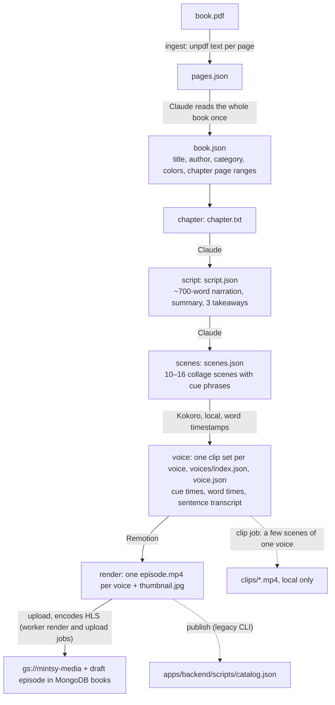
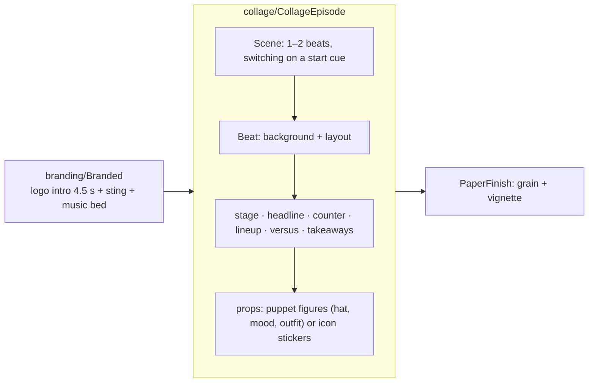

# Studio (`mintsy-web/apps/studio`)

This app is its own pnpm workspace with its own lockfile, so Remotion stays out of the backend image. Install with `pnpm install` in `apps/studio`.

A TypeScript pipeline plus a Remotion project that turns a book PDF into finished episodes, one ~5-minute narrated, animated video per chapter: script, animated scenes, narration, rendered MP4, HLS, and a **draft** episode in MongoDB `books`, the catalog's source of truth. Staff drive it from the [admin dashboard](admin.md), which queues jobs that `pnpm worker` runs on a staff machine, and publish the drafts there. The CLI still works for hand runs.

## Workflow



Every step writes a file in `work/<book>/ep-<nn>/` (`book.json` and `pages.json` in `work/<book>/`) that can be read and edited. A step is skipped when its output exists, so hand edits survive. `--from <step>` regenerates from that step on (for example `--from scenes` after editing `script.json`, `--from render` after changing a template), and `--to <step>` stops early (for example `--to scenes` to review before voicing).

```sh
pnpm worker                       # runs queued studio_jobs from the admin dashboard, one at a time
pnpm run pipeline ingest ~/Books/the-science-of-getting-rich.pdf --book the-science-of-getting-rich
pnpm run pipeline episode --book the-science-of-getting-rich --chapter 4 [--from scenes] [--to voice]
pnpm run pipeline publish --book the-science-of-getting-rich --chapter 4   # legacy: writes catalog.json
```

(`pnpm run` is required: pnpm 12 has its own `pipeline` command.)

The `--book` id becomes the book's id in the app; use the existing id (for example `the-science-of-getting-rich`) to fill in that series' episodes.

## Steps in detail

| Step | Code | Notes |
|---|---|---|
| ingest | `pipeline/steps/ingest.ts` | Extracts text per page; Claude reads the book once for title, author, category, colors and chapter page ranges. Fails early on scanned PDFs with no text. Chapter ranges use PDF page indices from `[page N]` markers. Output: `book.json`, `pages.json`. |
| chapter | `ingest.ts › writeChapter` | Cuts the chapter's pages out into `chapter.txt`. Neighbouring chapters can share a boundary page. |
| script | `pipeline/steps/script.ts` | Structured output (`generate()` below). A one-line summary, 3 takeaways and narration. Rules: 650–750 words, written for the ear, only facts from the chapter, original wording, at most one short attributed quote. Output: `script.json`. |
| scenes | `pipeline/steps/scenes.ts` | Claude splits the narration into 10–16 scenes and picks what's on screen, with cue phrases that time on-screen items to the voice. Collage format by default (`VIDEO_STYLE=cards` for the older text cards; `render` picks the composition from the scenes' format). Validated: narration copied verbatim, every cue phrase in its scene, icon names known, last scene ends with takeaways; one retry with the specific problems. If the script is unchanged, the existing scene split is kept so cached narration stays valid and only the visuals change. Output: `scenes.json`. |
| voice | `pipeline/steps/voice.ts`, `pipeline/tts.ts`, `tts/kokoro_tts.py` | Kokoro narrates each scene locally in every voice in `KOKORO_VOICES` (default `af_heart,am_michael,bm_george`); the Python process starts only when a clip isn't cached. Writes `audio/kokoro-<voice>/NN.mp3` + `NN.json`, `voices/kokoro-<voice>.json`, `voices/index.json`, and `voice.json`, a copy of the first voice's track (default `kokoro-af_heart`). The first voice is the episode's default, and each voice gets its own video. Cached per scene by hash of voice + speed + text, so only changed narration is voiced again. Kokoro returns word timestamps, which `wordsToAlignment` spreads over the characters of the text; these give each cue's time, each word's time and one transcript line per sentence, offset by the 4.5 s intro. |
| render | `pipeline/steps/render.ts`, `pipeline/voices.ts` | Bundles Remotion once, with a temporary public dir holding only `audio/` and `brand/`, and picks `CollageEpisode` or `Episode` from the scenes' format. For each voice, renders 1280×720 H.264 at CRF 20 and moves the MP4 index to the front with ffmpeg (faststart). The default voice goes in the episode folder and the others in `renders/kokoro-<voice>/`, so this takes about three times as long with three voices. Each folder gets `props.json` for Studio previews and `render-stamp.json`, which records the voice track it was rendered from. Collage episodes render with `captions: false`: the app draws captions from timed text. One thumbnail per episode, from the default voice: the designed `CollageThumbnail` at 528 px for collage with polish on, otherwise a 264-px frame. Stops with an error if `voices/index.json` doesn't match `KOKORO_VOICES`. |
| upload (worker `render`, `upload` and `remaster` jobs) | `pipeline/steps/publish.ts › uploadMedia`, `pipeline/steps/hls.ts`, `pipeline/transcode.sh` | First checks each voice's `render-stamp.json` against its current track. A missing or different stamp stops the upload with "rerun with `--from render`", so a video can't be paired with timings from another voice run, and a render from before captions came off can't be uploaded. An episode voiced before Kokoro has one track and skips this check. Then encodes every voice's `episode.mp4` to HLS with local ffmpeg (1080p/720p/360p H.264 + AAC fMP4, no upscaling, aligned 6 s keyframes) into its `hls/`, and uploads with `gcloud storage cp`, using the [service account key](#upload-credentials), under a content-hashed name per voice (`books/<book>/<chapter>-<hash8>.mp4` and `books/<book>/<chapter>-<hash8>/master.m3u8` + `stream_N/`, `master.m3u8` last; the one JPG uses the default voice's prefix; `Cache-Control: private, max-age=31536000`; the bucket may be private, with the backend issuing signed URLs). The worker then writes the episode to `books`: `render` and `upload` upsert it (title, summary, takeaways, transcript, duration, paths, `voices`) as a draft, always, even if it was published, and `remaster` swaps its media in place. Any encode or upload failure fails the job and saves nothing. The MP4s stay: offline downloads and existing app builds use them. |
| publish (legacy CLI) | `pipeline/steps/publish.ts` | Same checks, encode and upload, but upserts the book and episode into `apps/backend/scripts/catalog.json` instead of MongoDB. `pnpm seed:catalog` now only inserts missing books, so this no longer updates an existing catalog. Use a worker `render` job to get episodes into MongoDB. |

**Episodes voiced before Kokoro** have flat `audio/NN.mp3` + `NN.json` clips and only `voice.json`, with no `voices/`. `--from render` keeps using that audio and makes one video, with no burned captions, and the episode gets `voices: []`. Rerunning the voice step (`--from voice` or earlier, or any worker `render` or `remaster` job, which always rerun it) narrates the whole episode again with Kokoro, changing its narrator and duration, replaces `voice.json` and leaves the flat clips unused. Video already in the bucket isn't affected until that happens.

## Worker

`pnpm worker` (`pipeline/worker.ts`) claims the oldest queued job in `<MONGODB_DB>.studio_jobs` atomically (`findOneAndUpdate` → `running`, `startedAt`, `workerId`), runs one at a time, streams console output into `log` (last 500 lines, flushed every second), and finishes as `succeeded` + `result` or `failed` + `error`. The dashboard inserts `{ kind, bookId, …, status: "queued", log: [], createdAt }`. Contract: [Studio jobs](../contracts.md#studio-jobs).

`<MONGODB_DB>` defaults to `mintsy_studio`, which holds `books`, `studio_jobs` and `studio_workers`, the only collections the worker touches. It needs readWrite there and has no access to `mintsy_app`. At startup the worker creates the `books {order:1}` and `studio_jobs {status:1, createdAt:1}` indexes if they're missing, because the backend never writes to this database.

The worker writes a heartbeat to `studio_workers` every 5 seconds, including the job features it supports (`render-preview`, `upload`, `cover`, `remaster`, `clip`), so the dashboard can tell whether anything is consuming the queue. On startup, `running` jobs with this worker's id are marked failed. Ctrl-C stops the worker after the current job; a second Ctrl-C aborts the job and marks it failed.

::: warning
Production stays on the old cluster and the flat `mintsy` database until the [database split](../backend/deployment/index.md#splitting-the-database) is done. Until then, a worker aimed at production data needs `MONGODB_DB=mintsy` set explicitly; the default points at a database the API doesn't read.
:::

| Kind | Input | Does | Writes to `books` | `result` |
|---|---|---|---|---|
| `ingest` | `bookId`, `pdfPath` | `ingest`, plus a local cover render | Inserts the book as `draft` with `episodes: []` and `order` after the last book, only if the id is new | `{ book: { title, author, category, description }, chapters: [{ number, title }] }` |
| `script` | `bookId`, `chapter`, `regenerate?` | Episode steps up to `scenes` (from `script` with `regenerate`) | Nothing | `{ script, scenes }` (contents of `script.json` / `scenes.json`) |
| `render` | `bookId`, `chapter`, `scriptJson?`, `scenesJson?`, `preview?` | Writes edited script/scenes if given, reruns from `voice` (from `scenes` if only the script's narration changed), renders every voice, encodes HLS, uploads. With `preview`, stops after rendering locally | Upserts the episode by `number` as `draft`, with `voices`. Nothing with `preview` | `{ durationSec, videoPath, thumbnailPath, hlsPath }`, or `{ durationSec, preview: true }` |
| `upload` | `bookId`, `chapter` | Encodes HLS and uploads the last local render of every voice, without rendering again | Upserts the episode by `number` as `draft`, with `voices` | `{ durationSec, videoPath, thumbnailPath, hlsPath }` |
| `cover` | `bookId`, `upload?` | Renders `work/<book>/cover.jpg` (1000×1500) from the book's metadata in `books`. With `upload`, uploads it as `books/<book>/cover-<hash8>.jpg` | With `upload`, sets `coverPath`, live in the app [within about 15 to 60 s](../backend/catalog/index.md#how-the-api-reads-it-and-how-fast-a-publish-shows) if the book is published | `{ coverPath? }` |

| `remaster` | `bookId`, `chapter`, `overwriteTranscript?` | Re-renders an existing episode from its local `script.json`, `scenes.json` and `book.json`: voice, render, upload. Never calls Claude. Takes no script, scenes or preview | Swaps `videoPath`, `thumbnailPath`, `hlsPath`, `durationSec`, `transcript` and `voices` in one write, live in the app [within about 15 to 60 s](../backend/catalog/index.md#how-the-api-reads-it-and-how-fast-a-publish-shows) on a published episode. Keeps the status, title, summary and takeaways | `{ durationSec, videoPath, thumbnailPath, hlsPath, voices, transcriptLinesChanged }` |
| `clip` | `bookId`, `chapter`, `voice?`, `startScene?`, `endScene?` | Renders a vertical clip into `clips/`. Only episodes 1 to `FREE_EPISODES`, because viewers of any later one land on the paywall | Nothing (only reads) | `{ videoPath, thumbnailPath, voice, startScene, endScene, durationSec, width, height, episodePublished }`, with paths relative to the episode folder |

**`overwriteTranscript`:** admin transcript edits exist only in `books`, so `remaster` refuses when transcript text there differs from what it would write, and names the lines. It checks before rendering, before uploading and again before the write, because an admin can save an edit during a render. Only text counts, not timing. With `overwriteTranscript: true` it replaces those lines and reports how many in `transcriptLinesChanged`. Nothing reaches `books` until every voice has rendered and uploaded, so a failure leaves the episode as it was, at worst with unreferenced objects in the bucket.

`STUDIO_WORKER_DRY_RUN=1` fakes every job's work and result (no Claude, Kokoro, Remotion, ffmpeg or bucket, and no files in `work/`) but still writes `studio_jobs` and `books`.

## Claude usage

`pipeline/claude.ts`, model `claude-opus-5-5`. Each text call spawns the Claude Code CLI as one `claude -p` run, on the Claude subscription login of whoever runs the worker. There is no API SDK, API fallback or toggle.

- `generate()`: structured output. The JSON Schema goes to `--json-schema`, and `structured_output` from the result is validated with zod (book info, script, text-card scenes).
- `generateJson()`: for the collage schema, which is too nested for constrained decoding. The JSON Schema goes in the system prompt, the reply is validated (structure, verbatim narration, cue phrases, icon names), and validation problems feed the one retry.

**Login:** `claude` must be installed, on the worker's `PATH`, and signed in to a Claude subscription. Before every call, `claude auth status` must report the subscription (a `claude.ai` login, or `CLAUDE_CODE_OAUTH_TOKEN` from `claude setup-token`) on the first-party provider, or the call fails and nothing is sent. The worker doesn't check at startup, so a missing login shows up as a failed job.

**Isolation:**

- Every `ANTHROPIC_*` variable is removed from the child's environment, so `ANTHROPIC_API_KEY` is ignored.
- `ant auth login` is no longer used. The child's `ANTHROPIC_CONFIG_DIR` points at a path that doesn't exist, which blocks a silent fallback to that profile.
- `--bare` can't be used, because it ignores the subscription login. Instead, each run has an empty temp dir as its working directory, no tools, no setting sources or MCP servers, no saved session, and its system prompt in a file.

**Limits and failures:**

- A call is killed after `STUDIO_CLAUDE_TIMEOUT_MS` (30 minutes by default). A prompt over 10 MB is refused before it's sent.
- There's no output token setting, but truncation is still detected and fails the call with `Claude ran out of output tokens`.
- Compaction is off, so a book too big for the context window fails rather than getting summarized.
- The studio sets no fallback model. The CLI can re-run a flagged request on another model, and the log then says `also answered by <model>`.

**Usage:** Claude text calls use the subscription's limits, shared with the same login's Claude Code sessions, not per-call API spend. A large run can reach a limit, and its jobs then fail with `Claude subscription usage limit reached`. [Retrying later](admin.md#generate-whole-book) is safe.

## Video system (Remotion)

Episodes use the **collage** style by default: diagonal stripes, paper cut-out cards, puppet figures, icon stickers, rubber stamps and condensed kinetic type, with paper grain and a vignette. Every episode opens with the mintsy logo intro (book and chapter on tape) and has a background music bed. Colors and the logo come from [`@mintsy/brand`](brand.md).



| Path | Contents |
|---|---|
| `src/collage/schema.ts` | The scene contract Claude fills in: one or two beats per scene, each a background plus a layout made of props that appear on spoken cue phrases |
| `src/collage/Layouts.tsx` | Layout renderers; the first element of each beat appears as it slides in |
| `src/collage/kit.tsx` | Stripes, puppets, stamps, kinetic lines, pop-ins, paper finish |
| `src/collage/polish.tsx` | Scene wipes, slow camera push, the speech map for ducking the music (on unless `STUDIO_POLISH=0`). Also the burned-in word captions, drawn only with the `captions` prop, which is separate from polish: `false` for episodes, `true` for clips |
| `src/collage/phrases.ts` | Groups words into caption phrases. `polish.tsx` draws them in clips, and `pipeline/voices.ts` stores them as each voice's timed text, so both break lines the same way |
| `src/collage/CollageClip.tsx` | The 1080×1920 `CollageClip` composition: whole scenes, burned-in captions, music bed from the first frame (there's no intro), then the end card |
| `src/collage/PortraitLayouts.tsx` | Portrait versions of the six layouts, from the same beats. Laid out in flow, so longer text moves its neighbours, and text always sits on a slab, card or tape |
| `src/collage/ClipEndCard.tsx` | The last 3.5 s of a clip: logo, book title and "Keep watching free on Mintsy", inside the safe area |
| `src/collage/clipLayout.ts` | Clip size, safe area, text zone and limits |
| `src/collage/covers.tsx` | Stills: the designed episode thumbnail and the book cover |
| `src/collage/icons.ts`, `iconNames.ts` | 119 [Phosphor](https://phosphoricons.com) icons (MIT) by friendly name. To add one, add the name to `iconNames.ts` and map it in `icons.ts` |
| `src/branding/` | Logo intro (wordmark animation, book and chapter on tape), sting and music bed with volumes (`Branded.tsx`) |
| `src/episode/` | Older text-card templates, shared timing (`FPS`, `INTRO_SEC`, `sceneFrames`) |
| `src/prototypes/` | Collage and AI-illustrated style prototypes (reference only) |
| `brand/` | `intro-sting.mp3`, `music-bed.mp3` (generated once with Google Lyria on Vertex AI) |

Timing is shared between the pipeline and the compositions (`src/episode/timing.ts`), so transcript times match the rendered video exactly.

`VIDEO_STYLE=cards pnpm run pipeline episode … --from scenes` regenerates the original text-card style instead.

### Vertical clips

A `clip` job (`pipeline/steps/clip.ts`) renders a few whole scenes of one voice to `clips/<voice>-sNN-sNN.mp4` and a `.jpg` poster, for manual posting. Nothing is uploaded.

Rules, from `src/collage/clipLayout.ts` and `selectClipScenes`:

- **Length:** 1 to 3 consecutive scenes. The scenes alone must run at least 15 s, and the finished clip, with its 3.5 s end card, at most 60 s.
- **Default range:** starts at scene 1, the scripted hook, and takes the fewest scenes that reach 15 s.
- **Format:** collage only. The job fails if `scenes.json` has changed since the voice track was made.
- **Unpublished episodes:** the job still renders, logs a warning and returns `episodePublished: false`.

The safe area is the strictest of the ad templates TikTok, Meta and Google publish for 1080×1920, checked 2026-11-03 through upload-post.com's table and adkit.so. Platforms publish no figures for organic posts, whose interface is usually smaller.

| | Top | Bottom | Left | Right |
|---|---|---|---|---|
| TikTok | 240 | 660 | 120 | 120, plus 300 on the right from y 840 down |
| Reels | 269 | 672 | 65 | 65 |
| Shorts | 288 | 672 | 48 | 192 |
| `CLIP_SAFE` (px from the frame's edge) | 288 | 672 (y 1248) | 120 | 192 (x 888), and 300 from y 840 down (x 780) |

Beat text stays in `CLIP_CONTENT` (x 140 to 868, y 322 to 980), which is enough inside the safe area to survive the camera's 4% push, and left of x 765 from y 840 down. Captions sit between that zone and the safe area's bottom edge, and `captionSize` picks the largest size that fits, from 56 down to 38.

To review a clip's layout, open `CollageClip` in Remotion Studio with `safeAreaGuide` on. Never set it on a clip that gets posted.

### Previewing and changing the look

`pnpm dev` opens Remotion Studio with sample props (`CollageEpisode` shows every layout). To preview a generated episode with its audio:

```sh
npx remotion studio --public-dir work/<book>/ep-<nn> --props work/<book>/ep-<nn>/props.json
```

Then open the `CollageEpisode` composition. (`render` writes `props.json`: book title, chapter, episode title, the voice's timed scenes and `captions: false`. To see another voice, use `--props work/<book>/ep-<nn>/renders/kokoro-<voice>/props.json`, with the same public dir.)

Adding a collage layout means adding it to `src/collage/schema.ts` (what Claude can ask for), `src/collage/Layouts.tsx` (how it's drawn) and `src/collage/PortraitLayouts.tsx` (how it's drawn in clips).

## Content rules

The script prompt (`pipeline/steps/script.ts`) requires narration in our own words, only facts from the chapter, and at most one short attributed quote. Review scripts before publishing: summaries of copyrighted books are only safe as genuinely original commentary.

## External services and costs

Claude runs on subscription limits rather than per-call spend. The other costs are approximate, per episode.

| Service | Use | Cost |
|---|---|---|
| Claude Opus 5.5, through the `claude` CLI | Script + scenes. Ingest once per book, with the whole book in context | Subscription limits, see [Claude usage](#claude-usage). The dollar figures admin still shows are [old API-rate estimates](admin.md#generate-whole-book) |
| Kokoro (local, Kokoro-82M, Apache 2.0) | Narration on the studio machine | No per-use cost |
| Remotion | Local render, a few minutes per voice on an M-series Mac | Free for companies of up to 3 people; larger teams need a [company license](https://www.remotion.pro/license) |
| Google Cloud Storage | Episode hosting | Pennies |

## Setup and configuration

Colors and the logo come from `@mintsy/brand`, and categories and catalog types from `@mintsy/shared`. Both are linked from `../../packages/`. In `apps/studio`:

```sh
pnpm install
cp .env.example .env     # everything in it is optional except MONGODB_URI for the worker
claude auth login        # Claude Code CLI on your Claude subscription; `claude` must be on the worker's PATH
brew install uv espeak-ng ffmpeg
(cd tts && uv sync)      # required: the Kokoro narration environment, about 1 GB with PyTorch
```

Tools: Node 24, pnpm, `claude` signed in to a Claude subscription and on the worker's `PATH`, `ffmpeg` and `ffprobe` on `PATH` (narration encodes MP3 with them, every upload encodes HLS), and, for uploads, the `gcloud` CLI on `PATH`. Uploads don't need `gcloud auth login` when a [service account key](#upload-credentials) is in place.

Narration needs no API key, but without `tts/.venv` a voice step with clips to make stops with an error giving the commands above. The first narration downloads the Kokoro model weights from Hugging Face. See `apps/studio/tts/README.md` for voices and the output layout.

Tests: `pnpm test` runs `pipeline/test/*.test.ts` with `DOTENV_CONFIG_PATH=/dev/null`, so `.env` isn't loaded. The job and dry-run suites run only with `STUDIO_TEST_MONGODB_URI` set to a local MongoDB, and refuse any other host. `pipeline/test/gcloud.test.ts` needs no MongoDB and reaches no bucket, because it uses a stub `gcloud` and a fake key, but its `uploadMedia` test runs the real `ffmpeg`.

`apps/studio/.env`:

| Variable | Default | |
|---|---|---|
| `STUDIO_CLAUDE_TIMEOUT_MS` | `1800000` (30 minutes) | How long one Claude call may run before it's killed |
| `KOKORO_VOICES` | `af_heart,am_michael,bm_george` | Voices to make for every episode, each rendered to its own video; the first is the default |
| `KOKORO_SPEED` | `1` | |
| `MEDIA_BUCKET` | `gs://mintsy-media` | |
| `STUDIO_GCP_KEY_FILE` | `~/.config/mintsy/studio-uploader.json` | Service account key for bucket uploads. See [Upload credentials](#upload-credentials) |
| `VIDEO_STYLE` | collage | `cards` for the older text cards |
| `STUDIO_POLISH` | on | `0` turns off the collage polish layer. Doesn't affect captions |
| `STUDIO_WORK_DIR` | `work/` | Use another folder, for example a scratch copy for test renders, so they can't overwrite real output. Admin reads the same variable for previews, so the two must match |
| `MONGODB_URI` | (required for the worker) | For example `mongodb://localhost:27017` |
| `MONGODB_DB` | `mintsy_studio` | Must match the admin dashboard's |
| `STUDIO_WORKER_DRY_RUN` | off | `1` fakes every job's work |
| `STUDIO_WORKER_ID` | hostname | Stored on claimed jobs |
| `STUDIO_WORKER_POLL_MS` | `2000` | How often to look for a queued job when idle |

### Upload credentials

`gcloud storage` uploads (MP4, HLS, thumbnail and cover) authenticate with a service account key instead of an interactive login, which expires and fails jobs. The account is `mintsy-studio-uploader@mintsy-prod.iam.gserviceaccount.com`, with `roles/storage.objectUser` on `gs://mintsy-media` only. Its key stays outside the repo at `~/.config/mintsy/studio-uploader.json`, mode 600.

`pipeline/gcloud.ts` picks the credential for each upload and logs which one it used. It takes the first of these that applies:

1. **`STUDIO_GCP_KEY_FILE`:** the file must exist, or the upload fails with an error naming the path. It also fails if an inherited `CLOUDSDK_AUTH_CREDENTIAL_FILE_OVERRIDE` names a different file. A leading `~` is expanded, and an empty value counts as unset.
2. **An inherited `CLOUDSDK_AUTH_CREDENTIAL_FILE_OVERRIDE`:** kept as it is. The upload fails if the file is missing.
3. **The default key path,** if the file exists.
4. **The ambient `gcloud` login,** which then needs access to `gs://mintsy-media`.

The check runs at the start of the upload, before any HLS encoding, but after the render in a `render` or `remaster` job. The key reaches only the `gcloud storage` children, through `CLOUDSDK_AUTH_CREDENTIAL_FILE_OVERRIDE`. `process.env` isn't changed, so anything else the process spawns keeps the user's own login.

**Replacing the key:** on another machine, or after revoking a key, create a new key for that service account at the default path, or point `STUDIO_GCP_KEY_FILE` at it.
