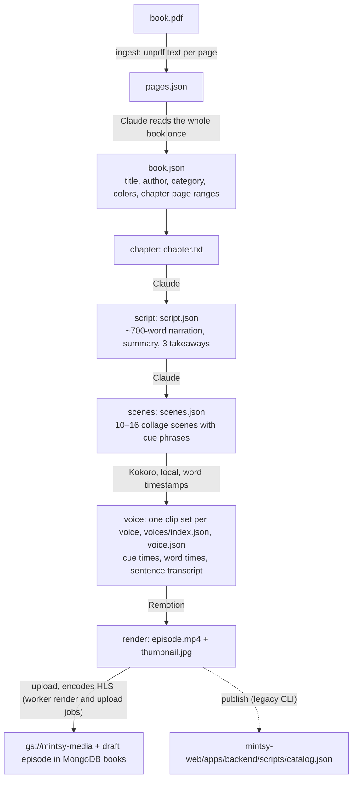
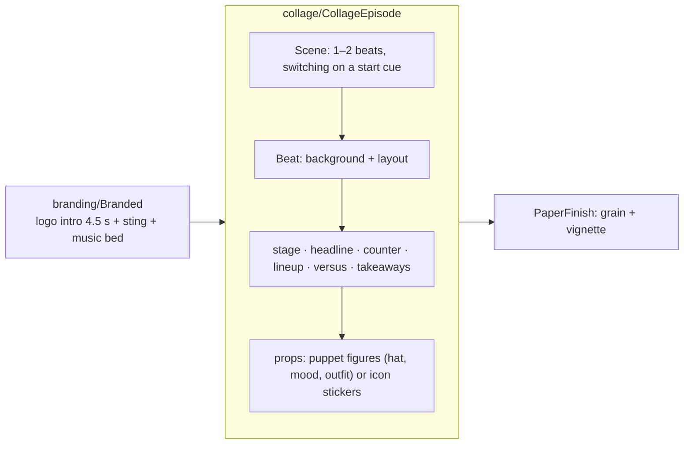

# Studio (`mintsy-studio`)

A TypeScript pipeline plus a Remotion project that turns a book PDF into finished episodes, one ~5-minute narrated, animated video per chapter: script, animated scenes, narration, rendered MP4, HLS, and a **draft** episode in MongoDB `books`, the catalog's source of truth. Staff drive it from the [admin dashboard](admin.md), which queues jobs that `pnpm worker` runs on a staff machine, and publish the drafts there. The CLI still works for hand runs.

## Workflow



Every step writes a file in `work/<book>/ep-<nn>/` (`book.json` and `pages.json` in `work/<book>/`) that can be read and edited. A step is skipped when its output exists, so hand edits survive. `--from <step>` regenerates from that step on (for example `--from scenes` after editing `script.json`, `--from render` after changing a template), and `--to <step>` stops early (for example `--to scenes` to review before voicing).

```sh
pnpm worker                       # runs queued studio_jobs from the admin dashboard, one at a time
pnpm run pipeline ingest ~/Books/psychology-of-money.pdf --book psychology-of-money
pnpm run pipeline episode --book psychology-of-money --chapter 4 [--from scenes] [--to voice]
pnpm run pipeline publish --book psychology-of-money --chapter 4   # legacy: writes catalog.json
```

(`pnpm run` is required: pnpm 12 has its own `pipeline` command.)

The `--book` id becomes the book's id in the app; use the existing id (for example `psychology-of-money`) to fill in that series' episodes.

## Steps in detail

| Step | Code | Notes |
|---|---|---|
| ingest | `pipeline/steps/ingest.ts` | Extracts text per page; Claude reads the book once for title, author, category, colors and chapter page ranges. Fails early on scanned PDFs with no text. Chapter ranges use PDF page indices from `[page N]` markers. Output: `book.json`, `pages.json`. |
| chapter | `ingest.ts › writeChapter` | Cuts the chapter's pages out into `chapter.txt`. Neighbouring chapters can share a boundary page. |
| script | `pipeline/steps/script.ts` | Structured output (`generate()` below). A one-line summary, 3 takeaways and narration. Rules: 650–750 words, written for the ear, only facts from the chapter, original wording, at most one short attributed quote. Output: `script.json`. |
| scenes | `pipeline/steps/scenes.ts` | Claude splits the narration into 10–16 scenes and picks what's on screen, with cue phrases that time on-screen items to the voice. Collage format by default (`VIDEO_STYLE=cards` for the older text cards; `render` picks the composition from the scenes' format). Validated: narration copied verbatim, every cue phrase in its scene, icon names known, last scene ends with takeaways; one retry with the specific problems. If the script is unchanged, the existing scene split is kept so cached narration stays valid and only the visuals change. Output: `scenes.json`. |
| voice | `pipeline/steps/voice.ts`, `pipeline/tts.ts`, `tts/kokoro_tts.py` | Kokoro narrates each scene locally in every voice in `KOKORO_VOICES` (default `af_heart,am_michael,bm_george`); the Python process starts only when a clip isn't cached. Writes `audio/kokoro-<voice>/NN.mp3` + `NN.json`, `voices/kokoro-<voice>.json`, `voices/index.json`, and `voice.json`, a copy of the first voice's track (default `kokoro-af_heart`) that the render uses. The other voices are stored for a future in-app choice. Cached per scene by hash of voice + speed + text, so only changed narration is voiced again. Kokoro returns word timestamps, which `wordsToAlignment` spreads over the characters of the text; these give each cue's time, each word's time and one transcript line per sentence, offset by the 4.5 s intro. |
| render | `pipeline/steps/render.ts` | Bundles Remotion with the episode folder as the public dir, picks `CollageEpisode` or `Episode` from the scenes' format, renders 1280×720 H.264 at CRF 20, moves the MP4 index to the front with ffmpeg (faststart), and renders the thumbnail: the designed `CollageThumbnail` at 528 px for collage with polish on, otherwise a 264-px frame. Writes `props.json` for Studio previews. |
| upload (worker `render` and `upload` jobs) | `pipeline/steps/publish.ts › uploadMedia`, `pipeline/steps/hls.ts`, `pipeline/transcode.sh` | Encodes `episode.mp4` to HLS with local ffmpeg (1080p/720p/360p H.264 + AAC fMP4, no upscaling, aligned 6 s keyframes) into `hls/`, uploads with `gcloud storage cp` under a content-hashed name (`books/<book>/<chapter>-<hash8>.mp4/.jpg` and `books/<book>/<chapter>-<hash8>/master.m3u8` + `stream_N/`, `master.m3u8` last; `Cache-Control: private, max-age=31536000`; the bucket may be private, with the backend issuing signed URLs). The worker then upserts the episode (title, summary, takeaways, transcript, duration, paths) into `books` as a draft, always, even if it was published. Any encode or upload failure fails the job and saves nothing. The MP4 stays: offline downloads and existing app builds use it. |
| publish (legacy CLI) | `pipeline/steps/publish.ts` | Same encode and upload, but upserts the book and episode into `mintsy-web/apps/backend/scripts/catalog.json` instead of MongoDB. `pnpm seed:catalog` now only inserts missing books, so this no longer updates an existing catalog. Use a worker `render` job to get episodes into MongoDB. |

**Episodes voiced before Kokoro** have flat `audio/NN.mp3` + `NN.json` clips and only `voice.json`, with no `voices/`. `--from render` keeps using that audio. Rerunning the voice step (`--from voice` or earlier, or any worker `render` job, which always reruns it) narrates the whole episode again with Kokoro, changing its narrator and duration, replaces `voice.json` and leaves the flat clips unused. Video already in the bucket isn't affected until that happens.

## Worker

`pnpm worker` (`pipeline/worker.ts`) claims the oldest queued job in `<MONGODB_DB>.studio_jobs` atomically (`findOneAndUpdate` → `running`, `startedAt`, `workerId`), runs one at a time, streams console output into `log` (last 500 lines, flushed every second), and finishes as `succeeded` + `result` or `failed` + `error`. The dashboard inserts `{ kind, bookId, …, status: "queued", log: [], createdAt }`. Contract: [Studio jobs](../contracts.md#studio-jobs).

`<MONGODB_DB>` defaults to `mintsy_studio`, which holds `books`, `studio_jobs` and `studio_workers`, the only collections the worker touches. It needs readWrite there and has no access to `mintsy_app`. At startup the worker creates the `books {order:1}` and `studio_jobs {status:1, createdAt:1}` indexes if they're missing, because the backend never writes to this database.

The worker writes a heartbeat to `studio_workers` every 5 seconds, including the job features it supports, so the dashboard can tell whether anything is consuming the queue. On startup, `running` jobs with this worker's id are marked failed. Ctrl-C stops the worker after the current job; a second Ctrl-C aborts the job and marks it failed.

::: warning
Production stays on the old cluster and the flat `mintsy` database until the [database split](../backend/deployment/index.md#splitting-the-database) is done. Until then, a worker aimed at production data needs `MONGODB_DB=mintsy` set explicitly; the default points at a database the API doesn't read.
:::

| Kind | Input | Does | Writes to `books` | `result` |
|---|---|---|---|---|
| `ingest` | `bookId`, `pdfPath` | `ingest`, plus a local cover render | Inserts the book as `draft` with `episodes: []` and `order` after the last book, only if the id is new | `{ book: { title, author, category, description }, chapters: [{ number, title }] }` |
| `script` | `bookId`, `chapter`, `regenerate?` | Episode steps up to `scenes` (from `script` with `regenerate`) | Nothing | `{ script, scenes }` (contents of `script.json` / `scenes.json`) |
| `render` | `bookId`, `chapter`, `scriptJson?`, `scenesJson?`, `preview?` | Writes edited script/scenes if given, reruns from `voice` (from `scenes` if only the script's narration changed), renders, encodes HLS, uploads. With `preview`, stops after rendering locally | Upserts the episode by `number` as `draft`. Nothing with `preview` | `{ durationSec, videoPath, thumbnailPath, hlsPath }`, or `{ durationSec, preview: true }` |
| `upload` | `bookId`, `chapter` | Encodes HLS and uploads the last local render, without rendering again | Upserts the episode by `number` as `draft` | `{ durationSec, videoPath, thumbnailPath, hlsPath }` |
| `cover` | `bookId`, `upload?` | Renders `work/<book>/cover.jpg` (1000×1500) from the book's metadata in `books`. With `upload`, uploads it as `books/<book>/cover-<hash8>.jpg` | With `upload`, sets `coverPath`, live at once if the book is published | `{ coverPath? }` |

`STUDIO_WORKER_DRY_RUN=1` fakes every job's work and result (no Claude, Kokoro, Remotion, ffmpeg or bucket, and no files in `work/`) but still writes `studio_jobs` and `books`.

## Claude usage

`pipeline/claude.ts`, model `claude-opus-5-5`, with server-side refusal fallbacks enabled.

- `generate()`: structured output via `betaZodOutputFormat` (book info, script, text-card scenes).
- `generateJson()`: for the collage schema, which is too nested for constrained decoding. The JSON Schema goes in the prompt, the reply is streamed and validated with zod (structure, verbatim narration, cue phrases, icon names), and validation problems feed the one retry.

Credentials: `ANTHROPIC_API_KEY` or the active `ant auth login` profile.

## Video system (Remotion)

Episodes use the **collage** style by default: diagonal stripes, paper cut-out cards, puppet figures, icon stickers, rubber stamps and condensed kinetic type, with paper grain and a vignette. Every episode opens with the mintsy logo intro (book and chapter on tape) and has a background music bed. Colors and the logo come from [`@mintsy/brand`](brand.md).



| Path | Contents |
|---|---|
| `src/collage/schema.ts` | The scene contract Claude fills in: one or two beats per scene, each a background plus a layout made of props that appear on spoken cue phrases |
| `src/collage/Layouts.tsx` | Layout renderers; the first element of each beat appears as it slides in |
| `src/collage/kit.tsx` | Stripes, puppets, stamps, kinetic lines, pop-ins, paper finish |
| `src/collage/polish.tsx` | Word-synced captions, scene wipes, slow camera push, the speech map for ducking the music. On unless `STUDIO_POLISH=0` |
| `src/collage/covers.tsx` | Stills: the designed episode thumbnail and the book cover |
| `src/collage/icons.ts`, `iconNames.ts` | 119 [Phosphor](https://phosphoricons.com) icons (MIT) by friendly name. To add one, add the name to `iconNames.ts` and map it in `icons.ts` |
| `src/branding/` | Logo intro (wordmark animation, book and chapter on tape), sting and music bed with volumes (`Branded.tsx`) |
| `src/episode/` | Older text-card templates, shared timing (`FPS`, `INTRO_SEC`, `sceneFrames`) |
| `src/prototypes/` | Collage and AI-illustrated style prototypes (reference only) |
| `brand/` | `intro-sting.mp3`, `music-bed.mp3` (generated once with Google Lyria on Vertex AI) |

Timing is shared between the pipeline and the compositions (`src/episode/timing.ts`), so transcript times match the rendered video exactly.

`VIDEO_STYLE=cards pnpm run pipeline episode … --from scenes` regenerates the original text-card style instead.

### Previewing and changing the look

`pnpm dev` opens Remotion Studio with sample props (`CollageEpisode` shows every layout). To preview a generated episode with its audio:

```sh
npx remotion studio --public-dir work/<book>/ep-<nn> --props work/<book>/ep-<nn>/props.json
```

Then open the `CollageEpisode` composition. (`props.json` is written by `render`: book title, chapter, episode title and the timed scenes from `voice.json`.)

Adding a collage layout means adding it to `src/collage/schema.ts` (what Claude can ask for) and `src/collage/Layouts.tsx` (how it's drawn).

## Content rules

The script prompt (`pipeline/steps/script.ts`) requires narration in our own words, only facts from the chapter, and at most one short attributed quote. Review scripts before publishing: summaries of copyrighted books are only safe as genuinely original commentary.

## External services and costs (per episode, approximate)

| Service | Use | Cost |
|---|---|---|
| Claude Opus 5.5 | Script + scenes. Ingest once per book, with the whole book in context, is ≈ $0.10–1.00 | ≈ $0.35–0.50 (from logged usage, `src/lib/generate-all.ts` in admin) |
| Kokoro (local, Kokoro-82M, Apache 2.0) | Narration on the studio machine | No per-use cost |
| Remotion | Local render, a few minutes on an M-series Mac | Free for companies of up to 3 people; larger teams need a [company license](https://www.remotion.pro/license) |
| Google Cloud Storage | Episode hosting | Pennies |

## Setup and configuration

Colors and the logo come from `@mintsy/brand`, and categories and catalog types from `@mintsy/shared`. Both are linked from `../mintsy-web/packages/`, so `mintsy-web` must be cloned next to this folder.

```sh
pnpm install
cp .env.example .env     # everything in it is optional except MONGODB_URI for the worker
ant auth login           # or set ANTHROPIC_API_KEY in .env
brew install uv espeak-ng ffmpeg
(cd tts && uv sync)      # required: the Kokoro narration environment, about 1 GB with PyTorch
```

Tools: Node 24, pnpm, `ffmpeg` and `ffprobe` on `PATH` (narration encodes MP3 with them, every upload encodes HLS), and, for uploads, `gcloud` signed in with access to `gs://mintsy-media`.

Narration needs no API key, but without `tts/.venv` a voice step with clips to make stops with an error giving the commands above. The first narration downloads the Kokoro model weights from Hugging Face. See `tts/README.md` in the studio repo for voices and the output layout.

`studio/.env`:

| Variable | Default | |
|---|---|---|
| `ANTHROPIC_API_KEY` | the `ant auth login` profile | Claude credentials |
| `KOKORO_VOICES` | `af_heart,am_michael,bm_george` | Voices to make for every episode; the first is rendered |
| `KOKORO_SPEED` | `1` | |
| `MEDIA_BUCKET` | `gs://mintsy-media` | |
| `VIDEO_STYLE` | collage | `cards` for the older text cards |
| `STUDIO_POLISH` | on | `0` turns off the collage polish layer |
| `MONGODB_URI` | (required for the worker) | For example `mongodb://localhost:27017` |
| `MONGODB_DB` | `mintsy_studio` | Must match the admin dashboard's |
| `STUDIO_WORKER_DRY_RUN` | off | `1` fakes every job's work |
| `STUDIO_WORKER_ID` | hostname | Stored on claimed jobs |
| `STUDIO_WORKER_POLL_MS` | `2000` | How often to look for a queued job when idle |
